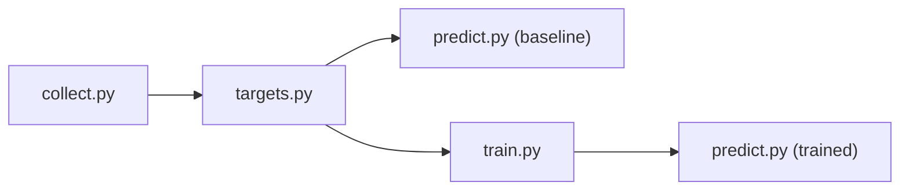

# Natural Language Actor-Critic (NLAC)

## Option 1

We train a critic to evaluate a segment of a frozen actor's DeepMath solution.
A segment spans one or more consecutive reasoning paragraphs. The critic
explains whether the reasoning in that segment is sound and how it might help
or hinder progress toward a solution.

The student critic sees the problem, the preceding reasoning, and the current
segment. A frozen teacher also sees the rest of the actor's recorded solution,
the verifier score, and the reference answer. The teacher uses that hindsight
to write a critique of the current segment. We fine-tune the student on these
critiques.

## Run Option 1



Run these commands from the repository root. Set `CUDA_VISIBLE_DEVICES` to one
available GPU and choose a fresh run name.

```sh
export CUDA_VISIBLE_DEVICES=0
export VLLM_USE_FLASHINFER_SAMPLER=0
nlac_run=nlac/option1

.venv/bin/python -m expts.nlac.collect \
    --output_dir "data/$nlac_run/corpus"

.venv/bin/python -m expts.nlac.targets \
    --corpus_dir "data/$nlac_run/corpus" --output_dir "data/$nlac_run/targets"

.venv/bin/python -m expts.nlac.predict \
    --targets_dir "data/$nlac_run/targets" --output_dir "results/$nlac_run/baseline"

.venv/bin/python -m expts.nlac.train \
    --targets_dir "data/$nlac_run/targets" --output_dir "models/$nlac_run"

.venv/bin/python -m expts.nlac.predict \
    --targets_dir "data/$nlac_run/targets" --model_name "models/$nlac_run/final" \
    --output_dir "results/$nlac_run/trained"
```

Compare `responses.txt` in the `baseline` and `trained` result directories to
see both critics' responses to the same validation segments.

## Files

| File | Purpose |
| --- | --- |
| [collect.py](collect.py) | Generates and scores DeepMath solutions from the frozen actor. |
| [targets.py](targets.py) | Samples segments from saved solutions and generates teacher critiques. |
| [train.py](train.py) | Fine-tunes the student critic on the saved critiques. |
| [predict.py](predict.py) | Saves baseline or trained critic responses on the same segments for comparison. |
| [prompts.py](prompts.py) | Builds the student and teacher prompts. |
| [data.py](data.py) | Reads and writes experiment data, segments reasoning traces, and parses critiques. |
| [generation.py](generation.py) | Loads models and runs vLLM sampling for collection, target generation, and prediction. |
| [\_\_init\_\_.py](__init__.py) | Marks `nlac` as a Python package. |
